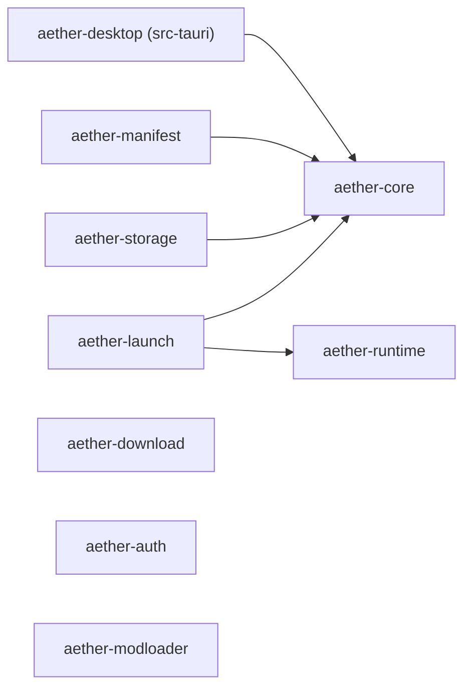

# 架构概览

Aether Launcher 分两层：Rust workspace 放领域逻辑，React 前端放界面，中间由 Tauri 2 的 IPC 连接。

```text
React + Fluent UI  ──(Tauri IPC)──  src-tauri (aether-desktop)  ──  crates/*
```

## Crate 依赖



`aether-core` 在最底层，只放实例和版本的基础类型。`download`、`auth`、`modloader`、`runtime` 目前互不依赖，也不依赖 core。

## Crate 一览

| Crate | 职责 | 现有内容 |
| --- | --- | --- |
| `aether-core` | 实例与版本的领域模型 | `InstanceId`（UUID v4）、`VersionId`（拒绝空串）、`InstanceState`（ready / incomplete / running / failed）、`GameInstance` |
| `aether-manifest` | Minecraft 版本元数据 | `parse_version_manifest` → `VersionManifest`（`id`、`inheritsFrom`、`mainClass`） |
| `aether-download` | 下载计划与校验 | `ArtifactSource`、`DownloadArtifact`（目标路径、大小、SHA-1、来源列表）、`DownloadPlan::validate` |
| `aether-auth` | 账户模型 | `AccountId`、`AccountKind`（Microsoft / Offline）、`AccountProfile` |
| `aether-runtime` | Java 运行时 | `JavaRuntime`（可执行文件、主版本、架构、厂商）、`supports` |
| `aether-launch` | 启动请求与计划 | `LaunchRequest`（实例 ID、内存）、`LaunchPlan`（运行时、工作目录、参数） |
| `aether-modloader` | 模组加载器 | `ModLoaderKind`（Fabric / Forge / NeoForge / Quilt）、`ModLoaderVersion` |
| `aether-storage` | 本地持久化 | `encode_instance` / `decode_instance`（`GameInstance` 的 JSON 编解码） |

按现有类型推断，启动一次游戏时的分工是：`manifest` 解析版本，`download` 生成并校验下载计划，`runtime` 选 Java，`launch` 组装启动计划，`storage` 保存实例。目前还没有代码把它们串起来。

## 前端结构

```text
src/
├── main.tsx          入口
├── App.tsx           外壳：主题、侧边栏、页面切换
├── navigation.tsx    页面清单（id、名称、图标、说明）
├── components/       Sidebar、PageHeader
├── pages/            HomePage；功能未做的页面共用 PlaceholderPage
├── ipc/              对后端命令的类型化封装
└── lib/              纯函数（问候语等）
```

没有路由库，页面切换就是 `App` 里的一个 state。

## IPC 边界

- 前端只通过 `src/ipc/` 调用后端，组件里不直接 `invoke`。
- 命令在 `src-tauri/src/lib.rs` 里用 `#[tauri::command]` 定义，并列进 `generate_handler!`。目前只有 `application_info`。
- 窗口权限在 `src-tauri/capabilities/default.json`，目前只有 `core:default`。这个目录在 CODEOWNERS 里单独列出。
- 命令是窄化的领域操作（导入这个实例、启动这个实例），参数用类型表达。不提供执行任意命令、读写任意路径的入口。

新增一个命令：

1. 逻辑放在对应 crate 里并写测试，`src-tauri` 里的命令只负责转换参数和结果。
2. 在 `src-tauri/src/lib.rs` 里添加命令函数，并加入 `generate_handler!`。
3. 需要新权限时修改 `capabilities/`。
4. 在 `src/ipc/index.ts` 的 `CommandResults` 里登记命令名和返回类型，再加一个封装函数和测试。

`call` 目前只支持无参数命令，第一个带参数的命令出现时一起扩展。

## 还没有的部分

- `aether-manifest` 只解析 `id`、`inheritsFrom`、`mainClass`。libraries、arguments、assets 等字段和继承合并都还没有。
- `aether-download` 的 `DownloadPlan::validate` 只检查来源非空和 SHA-1 格式。`destination` 是任意 `PathBuf`，没有限制必须落在实例目录内。下载和写盘本身还没有实现。
- `aether-runtime` 的 `JavaRuntime::supports` 要求主版本完全相等。Java 的发现和探测还没有实现。
- `aether-auth` 只有账户模型，没有 Microsoft / Xbox / Minecraft 登录流程，也没有凭据存储。
- `aether-storage` 只做 JSON 编解码，不读写磁盘。
- `aether-launch` 只检查内存范围（512–131072 MiB）。它不生成参数，也不启动进程。
- `aether-modloader` 目前只有类型。
